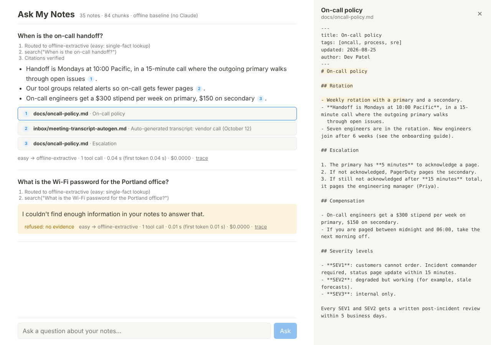
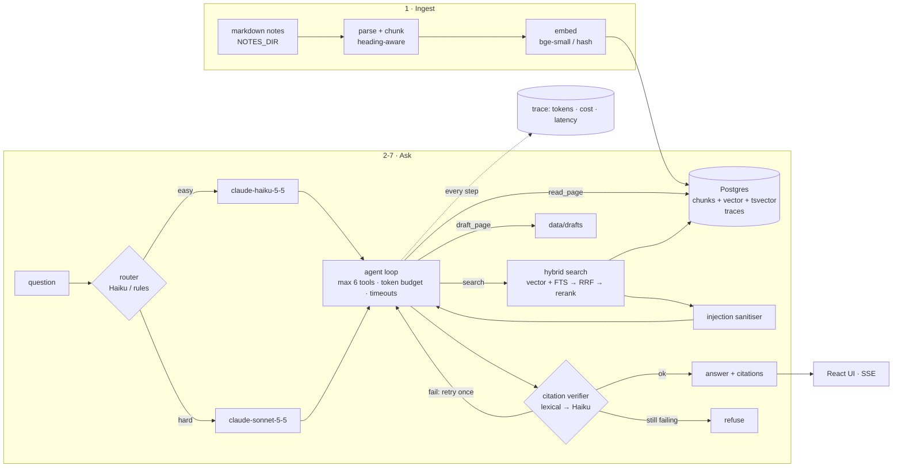

# Ask My Notes

A Notion-style AI assistant over a folder of markdown notes, built as a portfolio project that covers
every stage of a production AI pipeline: **ingest → hybrid retrieval → cited answers → tool-using agent
→ evals in CI → guardrails → latency/cost routing → chat UI**, with a beginner-friendly write-up of
each stage in [`docs/learn/`](docs/learn/).



- **TypeScript / Node 22**, **React** (Vite), **Postgres 16 + pgvector** (vectors and full-text search in one database).
- **Claude** via the official SDK: `claude-sonnet-5-5` for hard questions, `claude-haiku-5-5` for easy
  ones, routing, and citation checks. Streaming, prompt caching, strict tool schemas.
- **Local embeddings** with transformers.js (`Xenova/bge-small-en-v1.5`), so no second API key is needed.
- A fictional **35-note sample corpus** (with 3 planted prompt-injection notes) and a **50-question golden set**.
- An **offline mode** (`LLM_PROVIDER=offline`, an extractive baseline) so tests, CI, and the UI run with no key.

> **Read this first: what was and was not measured.** This repo was built in a sandbox with **no
> Anthropic API key** and **no access to huggingface.co**. So every number below was measured with the
> hash embedder and, for end-to-end runs, the offline extractive baseline. Numbers that need Claude
> are marked *not measured*, with the command that produces them. Nothing here is invented. See
> [docs/DECISIONS.md](docs/DECISIONS.md) D-004 and D-008.

## Architecture



The agent loop follows the graph in [docs/learn/04-agent.md](docs/learn/04-agent.md).

## Run locally

Prerequisites: Node 22+, and Postgres 16 with pgvector. The easiest way to get Postgres is
`docker compose up -d db`; alternatively install `postgresql-16-pgvector` and create a `notes` user and database.

```bash
git clone <this repo> && cd ask-my-notes
cp .env.example .env            # add ANTHROPIC_API_KEY, or set LLM_PROVIDER=offline
npm install
docker compose up -d db         # Postgres + pgvector on :5432
npm run ingest                  # index ./corpus/sample (first run downloads the ~35 MB embedding model)
npm run ask -- "When is the on-call handoff?"                    # one-shot RAG answer
npm run agent -- "Why did the Harbor cutover slip, and what fixed it?"   # agent with tools
npm run build && npm start      # UI + API on http://localhost:8787
```

**Your own notes:** set `NOTES_DIR=./notes` (git-ignored) or any folder outside the repo, then
`npm run ingest`. `.env`, `notes/`, `private-notes/`, `data/` (traces, drafts), and `evals/runs/` are
all git-ignored. Never commit them.

| Command | What it does |
|---|---|
| `npm test` | 89 tests across all 8 stages (needs Postgres; DB tests skip without it) |
| `npm run eval:retrieval` | recall@1/3/5/10, MRR, latency per retrieval mode |
| `npm run eval:full` | agent on all 50 golden questions, graded (deterministic + LLM judge with a key) |
| `npm run eval:guardrails` | citation verifier and injection detector on labelled data |
| `npm run eval:judge-agreement` | graders vs 24 human labels (re-label them yourself) |
| `npm run eval:router` | router accuracy vs difficulty labels |
| `npm run report:latency` | p50/p95, TTFT, $/question, time per step, from logged traces |
| `npm run estimate:cost` | projected Claude cost from offline traces (**estimate**) |
| `npm run eval:regrade -- <run.jsonl>` | re-grade a saved eval run without re-running the agent |

## Numbers

Measured 2026-10-28 on the sample corpus (35 notes, 84 chunks). Configuration: `EMBEDDER=hash`,
`RERANKER=none`, `LLM_PROVIDER=offline` unless stated.

### Measured

| Metric | Value |
|---|---|
| Retrieval recall@5 (hybrid, 46 answerable questions) | **97.8%** |
| Retrieval recall@1 / MRR: hybrid · vector · keyword | **79.3% / 0.877** · 68.5% / 0.794 · 75.0% / 0.851 |
| Retrieval recall@1 with heuristic re-ranker | 72.8% (worse than hybrid, so it is off; see D-006) |
| Retrieval latency p95 (hybrid) | ~4 ms |
| End-to-end pass rate, **offline extractive baseline** | **36.0%** (18/50); 34.0% before guardrails |
| Deterministic grader vs human labels | 91.7% agreement, Cohen's kappa 0.83 (24 labels) |
| Citation verifier (lexical tier) on 39 labelled claims | 82.1% accuracy; catches 75% of unsupported claims |
| Prompt-injection detector | 15/15 attacks, 0/15 benign look-alikes; 3/3 planted notes, 0/32 clean notes |
| Router (heuristic) vs difficulty labels | 86.0% accuracy; 64% of questions go to Haiku |
| Pipeline overhead without the model, p95 | ~11 ms per question |

### Not measured (need `ANTHROPIC_API_KEY`), and how to get them

| Metric | Command |
|---|---|
| End-to-end pass rate with Claude (judge AND deterministic) | `LLM_PROVIDER=anthropic npm run eval:full -- --write-baseline` |
| p95 latency, time to first token, and $/question with Claude | same run, or `npm run report:latency` |
| LLM judge agreement with human labels | `npm run eval:judge-agreement -- --write-baseline` |
| Citation verifier with the Haiku tier | `npm run eval:guardrails -- --write-baseline` |
| Haiku router accuracy | `npm run eval:router` |
| Retrieval with the neural embedder / cross-encoder | `EMBEDDER=transformers RERANKER=cross-encoder npm run ingest -- --force && npm run eval:retrieval` |

### Estimates (not measurements)

From offline traces (measured prompt sizes and call counts, assumed output sizes; `npm run estimate:cost`):
**~$0.0044 per question** routed and cached (hard/Sonnet ~$0.011, easy/Haiku ~$0.0005), versus
~$0.012 with everything on Sonnet and no caching.

## Tests and CI

`.github/workflows/evals.yml` runs on every pull request:

1. **offline** job (no secrets, fully deterministic): typecheck, all tests, ingest, then three gates
   against [`evals/baseline.json`](evals/baseline.json): retrieval recall@5, guardrail metrics, and
   the offline end-to-end pass rate (zero tolerance). Builds the UI.
2. **claude** job (only if the repo has an `ANTHROPIC_API_KEY` secret): the full eval with the LLM
   judge, failing the PR if the pass rate drops more than 3 questions below the recorded Claude
   baseline. Record that baseline once with a key and commit `evals/baseline.json`.

## Deploy

Not deployed. These are the exact steps. Neither path was executed in the build sandbox, which
had no Docker daemon and no cloud credentials.

**Before exposing it anywhere: set `BASIC_AUTH=user:a-long-password` and use HTTPS.** Your notes are private.

### Option A: one Linux VM with Docker Compose (simplest)

```bash
# on the server (Ubuntu 24.04, Docker installed: https://docs.docker.com/engine/install/ubuntu/)
git clone <this repo> /srv/ask-my-notes && cd /srv/ask-my-notes
cp .env.example .env
#   edit .env: ANTHROPIC_API_KEY=..., LLM_PROVIDER=anthropic, EMBEDDER=transformers,
#              RERANKER=cross-encoder, BASIC_AUTH=you:long-password
mkdir -p /srv/notes && rsync -a ~/my-notes/ /srv/notes/        # your markdown
sed -i 's#./corpus/sample:/notes:ro#/srv/notes:/notes:ro#' docker-compose.yml
docker compose up -d --build                                     # db + app (ingests on start)
docker compose logs -f app                                       # wait for "Ask My Notes API on ..."
# HTTPS with Caddy (automatic Let's Encrypt), with notes.example.com pointing at this server:
sudo apt install -y caddy
echo 'notes.example.com {
  reverse_proxy localhost:8787
}' | sudo tee /etc/caddy/Caddyfile && sudo systemctl reload caddy
# after editing notes: re-index (incremental)
docker compose exec app npm run ingest
```

### Option B: Fly.io + Neon (managed Postgres with pgvector)

```bash
# 1. Database: create a project at https://neon.tech, then in its SQL editor:
#      CREATE EXTENSION IF NOT EXISTS vector;
#    copy the connection string (postgres://...?sslmode=require)
# 2. App
fly launch --no-deploy --name ask-my-notes        # detects the Dockerfile; say no to Fly Postgres
fly volumes create notes_data --size 1            # persistent volume for your notes
cat >> fly.toml <<'TOML'
[mounts]
  source = "notes_data"
  destination = "/notes"
TOML
fly secrets set ANTHROPIC_API_KEY=sk-ant-... DATABASE_URL='postgres://...neon.tech/neondb?sslmode=require' \
  BASIC_AUTH='you:long-password' LLM_PROVIDER=anthropic EMBEDDER=transformers RERANKER=cross-encoder
fly deploy
# 3. Upload notes, then re-index
tar czf notes.tgz -C ~/my-notes .
fly ssh sftp shell        # at the sftp prompt:  put notes.tgz /notes/notes.tgz   then Ctrl-D
fly ssh console -C "sh -c 'cd /notes && tar xzf notes.tgz && rm notes.tgz && cd /app && npm run ingest'"
fly open
```

Fly.io terminates HTTPS for you. Fly machines may stop when idle; the first request after that pays a
cold start plus the embedding-model load (a few seconds).

## Repository map

```
corpus/sample/        fictional notes (+ 3 prompt-injection notes in inbox/)
src/ingest/           parse.ts, chunk.ts, ingest.ts         stage 1
src/embed/            hash.ts, transformers.ts, text.ts     stage 1
src/retrieve/         vector.ts, fulltext.ts, hybrid.ts, rerank.ts, search.ts   stage 2
src/answer/           prompt.ts, answer.ts, citations.ts    stage 3
src/llm/              client.ts, offline.ts, pricing.ts     stage 3
src/agent/            agent.ts, tools.ts, router.ts, sources.ts, prompt.ts   stage 4
src/eval/ + evals/    golden set, graders, judge, runners, baseline.json     stage 5
src/guardrails/       injection.ts, verify.ts, structural.ts                 stage 6
evals/report-latency.ts, estimate-cost.ts, run-router.ts                     stage 7
src/server/ + web/    Express SSE API, React UI                              stage 8
tests/                one test file per stage
docs/learn/           one beginner write-up per stage
docs/DECISIONS.md     every decision, its alternatives, and what would change it
```

## Learn from it

Start with [docs/LEARN_PATH.md](docs/LEARN_PATH.md): the reading order with time estimates. Each
stage doc covers what the stage does, the concepts with analogies, a code walkthrough, decisions,
how to run it, exercises, and interview questions.

## License

MIT
