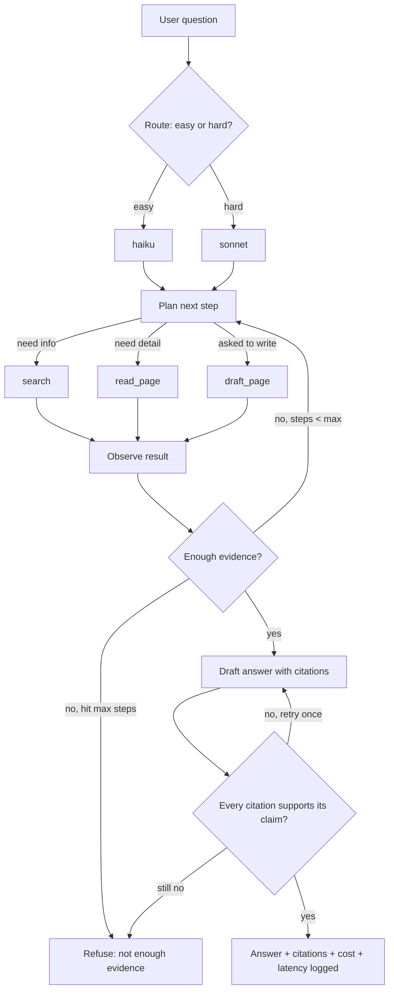

# Stage 4: Agent

> Instead of one fixed "retrieve then answer" step, let the model decide what to look up next,
> using tools (`search`, `read_page`, `draft_page`), inside a loop that code keeps on a short leash.

## 1. What this stage does

Some questions need more than one lookup. "Why did the Harbor cutover slip, and what fixed it?"
might need the project page *and* the meeting where the slip was decided. An agent can search,
read what came back, and decide to search again or read a full page before it answers.



A real trace (offline baseline, `npm run agent -- "Summarize the Sprint 18 retrospective."`):

```
→ route: hard (asks for a summary) → offline-extractive
→ search({"query":"Summarize the Sprint 18 retrospective."})
→ read_page({"path":"meetings/2026-10-06-sprint-18-retro.md"})
→ verify: ok
```

## 2. Concepts

**Tool use (function calling).** You describe functions (name, description, JSON schema). The model
replies with a `tool_use` block ("call `search` with `{query: ...}`") and stops with
`stop_reason: "tool_use"`. *Your code* runs the function and sends back a `tool_result`. The model
never executes anything itself. *Analogy:* a manager who can only send emails asking you to do
things; you do them and reply with the results.

**The agent loop.** `while (model asks for tools) { run tools; send results; ask again }`. The
"plan / observe / enough evidence?" boxes in the diagram are the model's reasoning inside each call;
the arrows are our loop.

**Hard stops.** A loop driven by a model must have limits enforced by code, not by asking nicely in
the prompt:
- **Max 6 tool steps.** Then refuse ("not enough evidence") rather than loop forever.
- **Token budget per question** (default 60k tokens across all calls). Bounds the worst-case cost.
- **Timeouts**: 5 s per tool call, 60 s per model call.
*Analogy:* a circuit breaker and a credit limit.

**Routing.** Most questions are simple lookups that a small, cheap, fast model handles well. A
router sends those to Haiku and the rest to Sonnet. (Measured in stage 7.)

**Parallel tool calls.** The model may request several tools in one turn. We run them concurrently
and return all results in a single message (splitting them teaches the model to stop doing it).

**Errors as observations.** A failing tool (wrong path, timeout) is returned to the model as a
`tool_result` with `is_error: true`, so it can fix its mistake ("Did you mean: ...?").

**Traces.** Every route decision, model call, tool call, and verification is recorded with inputs,
outputs, tokens, cost, and timing. *Analogy:* a flight recorder. Evals replay traces to grade runs
without re-paying for them.

## 3. Code walkthrough (read in this order)

1. `src/agent/tools.ts`: `TOOL_DEFS` (what Claude sees; note `strict: true` and descriptions that say
   *when* to use each tool), `runTool()` (validates input with zod, then runs), `withTimeout()`.
   `draft_page` writes to `data/drafts/`, never into your notes.
2. `src/agent/sources.ts`: `SourceRegistry` gives each chunk one id (`S1`, `S2`, ...) for the whole run,
   whichever tool surfaced it.
3. `src/agent/router.ts`: `heuristicRoute()` (regex rules, explainable) and `llmRoute()` (asks Haiku
   for one word, thinking disabled, 16 max tokens; falls back to the heuristic on any problem).
4. `src/agent/prompt.ts`: `AGENT_SYSTEM_PROMPT` (stage 3 rules + tool rules) and `retryMessage()`.
5. `src/agent/agent.ts`: `runAgent()`, the loop. Read it top to bottom; the three numbered sections
   match the diagram: route, plan/act/observe, verify/retry/refuse.
6. `src/guardrails/structural.ts`: the stage 4 verifier (cited ids exist; factual sentences cite
   something). Stage 6 swaps in a verifier that checks *support*.
7. `tests/stage4-agent.test.ts`: every hard stop and branch of the diagram, driven by `FakeLLM`.

## 4. Decisions

- **A hand-written loop** instead of the SDK's Tool Runner (D-011): the diagram has custom branches
  (route, verify, retry once, refuse) that are clearer as plain code.
- **Hard stops** at 6 steps / 60k tokens / 5 s / 60 s (D-012).
- **Drafts are saved for review**, never written into `NOTES_DIR` (D-013): an agent writing into the
  corpus it searches could pollute future answers, including with injected text.
- **Router defaults to the LLM router with a heuristic fallback** (D-014), per the brief.

## 5. Run it

```bash
npm run agent -- "Why did the Harbor cutover slip, and what fixed it?"
npm run agent -- "Draft a short page summarizing Project Harbor for the engineering all-hands."
ls data/drafts/
psql "$DATABASE_URL" -c "select question, status, route, jsonb_array_length(steps) steps, latency_ms from traces order by created_at desc limit 5;"
npx vitest run tests/stage4-agent.test.ts
```

## 6. Exercises

1. Set `maxToolSteps: 1` in `src/agent/cli.ts` and ask the summary question. Which branch of the
   diagram fires? Now find the test that covers it.
2. Add a fourth tool, `list_pages({folder})`, that returns note paths in a folder. Write a FakeLLM test
   that calls it. How should its description differ from `search`'s so the model picks the right one?
3. Lower `TOKEN_BUDGET` to 5000 and run a hard question with a real key. Read the trace: on which
   call did it stop, and how much of the budget was cache reads?

## 7. Interview questions

1. **What is the difference between a RAG pipeline and an agent?** A pipeline runs fixed steps;
   an agent lets the model choose the next action (which tool, when to stop) inside a loop.
   Agents handle multi-step questions but cost more and fail in more ways.
2. **How do you stop an agent from looping forever or running up a bill?** Code-enforced limits:
   max steps, token/cost budget, timeouts per call and overall, and a defined refusal path when a
   limit is hit, all logged in the trace.
3. **How should tool errors be handled?** Return them to the model as error results with an
   actionable message, so it can recover; do not crash the run and do not hide the error.
4. **Why route between models?** Most traffic is easy; a small model answers it at a fraction of the
   cost and latency. The risk is misrouting hard questions, so you measure router accuracy and
   per-route quality.
5. **How do you test an agent deterministically?** Scripted fake model responses to drive each
   branch (tool call, error, max steps, budget, retry), assertions on the requests sent and on the
   trace, plus a separate eval with the real model for quality.
